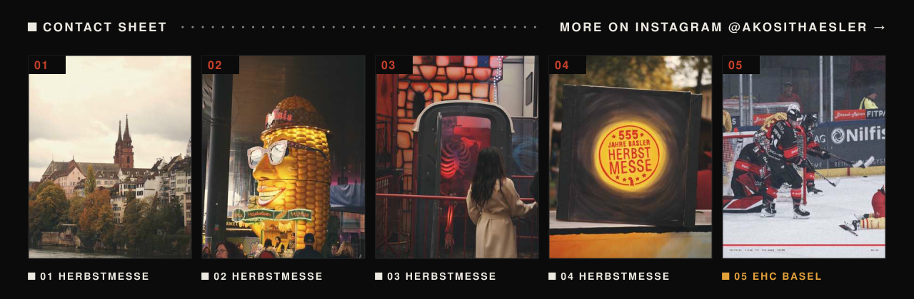
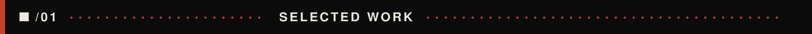
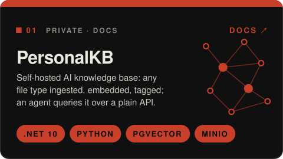
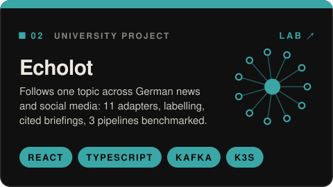
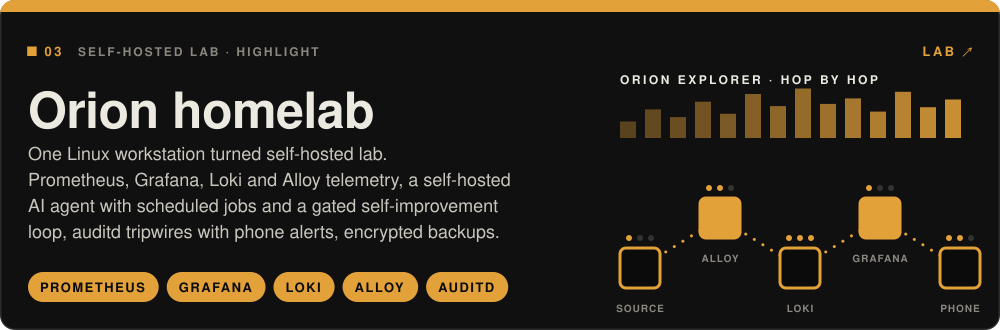
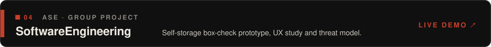
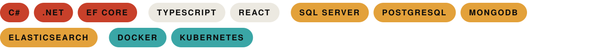

Software engineering student and photographer in the Basel / Lörrach area. Computer Science (Cyber Security) at DHBW Lörrach, dual study.

Backend and platform work in C# / .NET and TypeScript: dual student at Eschbach GmbH (Seqonis), freelance at Runom GmbH. Second study thesis (Nov 2026): an audit-log store for a multi-tenant PostgreSQL platform.

One Linux workstation turned self-hosted lab: Prometheus / Grafana / Loki telemetry, a self-hosted AI agent with scheduled jobs, auditd alerts, encrypted backups.

Fujifilm X-T3, graded filmic and warm. Autumn fair, ice hockey, old-town nights. [Herbstmesse 2026](https://julianthaesler.com/photography/herbstmesse-2026/) · [EHC Basel](https://julianthaesler.com/photography/ehc-basel/)

<table>
<tr>
<td></td>
<td></td>
</tr>
<tr>
<td colspan="2"></td>
</tr>
<tr>
<td colspan="2"></td>
</tr>
</table>

  
